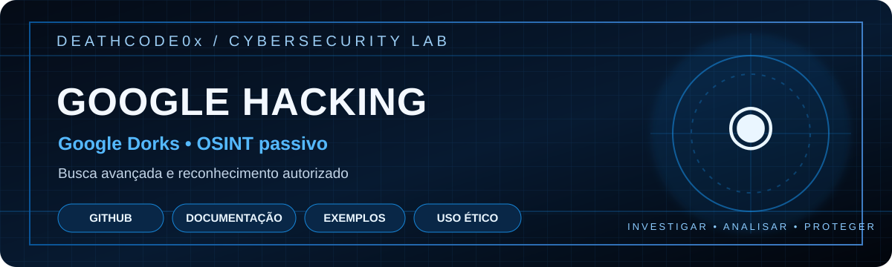

<p align="center">
  <a href="https://github.com/ArturDeathCode0x/Google-Hacking"></a>
  <a href="https://www.google.com/"></a>
  
  
</p>

> Pesquisa avançada com Google Dorks e OSINT passivo.

---

# Google Hacking

**Google Dorks • OSINT passivo • Reconhecimento autorizado**

Repositório de estudo sobre operadores de pesquisa avançada para localizar e analisar informações que já estejam publicamente indexadas.

## Objetivos
- Aprender operadores de pesquisa avançada.
- Entender conceitos de footprinting e OSINT.
- Documentar possíveis exposições em ativos próprios.
- Produzir registros úteis para auditorias autorizadas.

## Operadores básicos

| Operador | Finalidade |
|---|---|
| `site:dominio.com` | Limitar resultados a um domínio |
| `filetype:pdf` | Filtrar por tipo de arquivo |
| `intitle:termo` | Procurar termo no título |
| `inurl:termo` | Procurar termo na URL |
| `intext:termo` | Procurar termo no conteúdo |
| `"frase exata"` | Buscar uma expressão exata |

## Exemplos seguros

Use apenas domínios próprios, ambientes de laboratório ou ativos com autorização explícita.

```text
site:example.com
site:example.com filetype:pdf
site:example.com intitle:documentacao
site:example.com inurl:blog
```

Os exemplos usam `example.com`, domínio reservado para documentação.

## Fluxo de trabalho
1. Defina o escopo e obtenha autorização.
2. Realize buscas passivas.
3. Registre consulta, data e URL pública.
4. Valide o achado sem tentar contornar autenticação ou controles.
5. Comunique possíveis exposições ao responsável.
6. Recomende correções e acompanhe a resolução.

## Estrutura sugerida
- `dorks/`: consultas organizadas por categoria.
- `notes/`: anotações e conceitos.
- `reports/`: modelos de relatório sem dados sensíveis.

## Aviso ético e legal
Conteúdo exclusivamente educacional e defensivo. Não use dorks para localizar credenciais, dados pessoais, documentos privados ou informações confidenciais. Não tente acessar sistemas ou áreas restritas. Testes somente em ativos próprios ou com autorização explícita.

---
**DEATHCODE0x** · Cybersecurity · OSINT · Ethical Hacking
